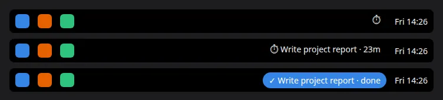
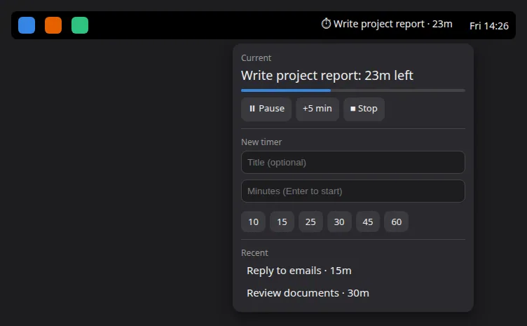

# Focus Timer

A small GNOME Shell extension that puts a focus timer in your top panel (works with Dash to Panel too). Give it an optional title like "Write project report" and a duration, and the panel shows what you're working on and how many minutes are left.





## Features

- Optional title, shown in the panel with the minutes left (`⏱ Write project report · 23m`)
- Presets for 10, 15, 25, 30, 45 and 60 minutes, or type any number of minutes and press Enter
- Pause, resume, +5 min and stop
- Notification and sound when the time is up
- Your last 5 titles are kept, so you can start a task again with one click
- Uses your GNOME accent color
- A running timer survives screen lock and logout

## Requirements

GNOME Shell 47 to 50.

## Install

```sh
git clone https://github.com/AliReza99/gnome-focus-timer.git
cd gnome-focus-timer
cp -r focus-timer@alireza ~/.local/share/gnome-shell/extensions/
```

Log out and back in (needed on Wayland), then enable it:

```sh
gnome-extensions enable focus-timer@alireza
```

## Usage

1. Click ⏱ in the panel.
2. Type a title (optional), then click a preset or type minutes and press Enter.
3. When the time is up, the button turns into a `✓ done` pill. Click it to clear it and start the next one.

## Uninstall

```sh
gnome-extensions uninstall focus-timer@alireza
rm -f ~/.config/focus-timer.json
```
